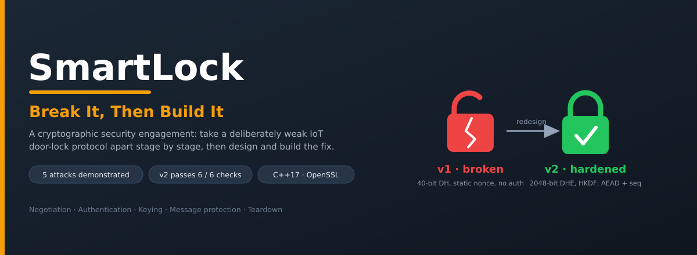
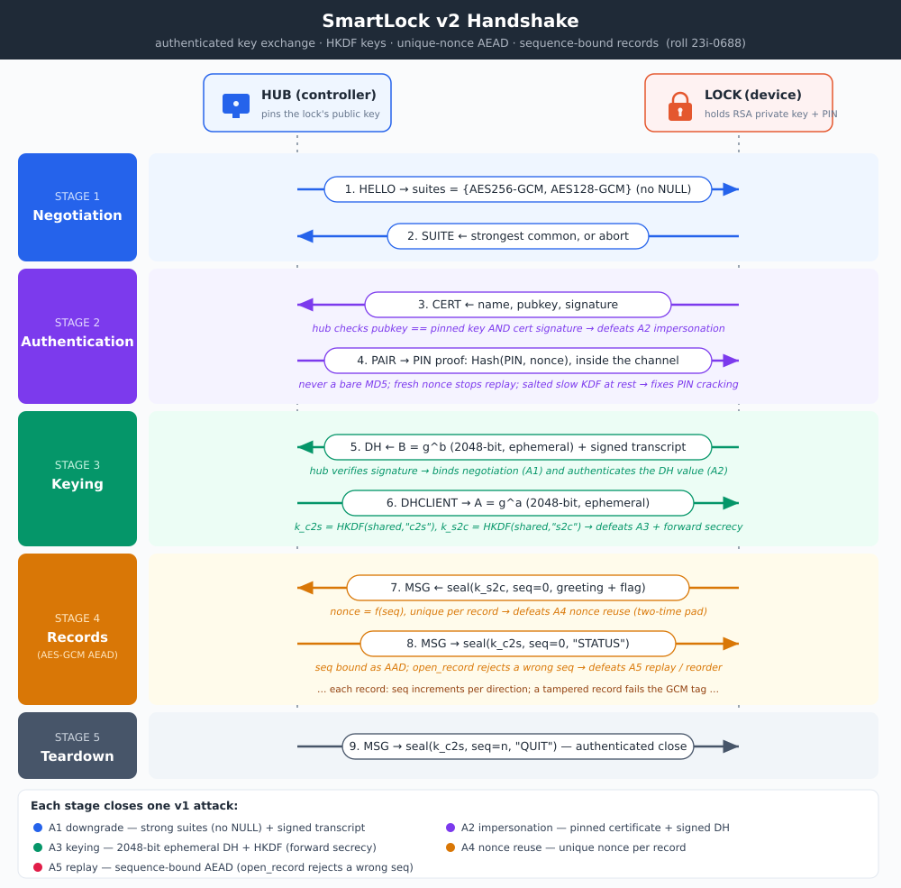

# SmartLock — Break It, Then Build It


-333)


A security engagement on a deliberately weak smart-door-lock protocol. I take the
shipped version (**v1**) apart stage by stage with working exploits captured on the
wire, then **design and build the corrected version (v2)** and prove every attack
now fails — finishing with an honest measurement of what the security costs.

The lock (server) and hub (client) speak a simple line-based protocol over TCP that
runs through five stages: **negotiation → authentication → keying → message
protection → teardown**. Each stage hides a real cryptographic mistake.

---

## The corrected protocol (v2)



Every v2 stage closes a specific v1 attack: strong-suite negotiation bound by a
signature, a pinned and verified device certificate, a fresh 2048-bit ephemeral
Diffie–Hellman exchange with HKDF-derived per-direction keys, a unique nonce per
record, and sequence numbers bound into the AEAD so replays and reordering are
rejected.

---

## Part A — breaking v1

Every value below is recovered **from captured traffic**, never read from the
device's config. One capture of a normal session feeds the passive attacks; the
on-path attacks use a small TCP relay (the lab's accepted stand-in for a
man-in-the-middle).

| # | Stage | Weakness | Exploit | Result | Property broken |
|---|-------|----------|---------|--------|-----------------|
| **A1** | Negotiation | `NULL` suite offered; negotiation unauthenticated | rewrite `HELLO` to offer only `NULL` | records sent in **cleartext** | confidentiality, integrity |
| **A2** | Authentication | self-signed cert never validated; DH unsigned | relay runs two key exchanges, presents an impostor cert | reads/alters **every record** | authentication |
| — | Authentication (PIN) | PIN sent as a fast, unsalted **MD5** | offline dictionary + 3-digit mask | **PIN recovered** | credential confidentiality |
| **A3** | Keying | ~40-bit DH prime; key = raw secret; static exponent | baby-step/giant-step **discrete log** | key rebuilt, **flag read**, no forward secrecy | key confidentiality, forward secrecy |
| **A4** | Message | one **static nonce** reused for every record | two-time-pad (XOR two records) | records read **without the key** | confidentiality, integrity |
| **A5** | Teardown | no sequence number or freshness | **replay** a captured `UNLOCK` | door reopens; unlock counter climbs | integrity, availability |

Exploits live in [`23i-0688-E/exploits/`](23i-0688-E/exploits); captures and tool
output in [`23i-0688-E/evidence/`](23i-0688-E/evidence).

---

## Part C — building v2

The security core is [`securelink2.cpp`](23i-0688-E/securelink2.cpp). The handshake
scaffold (strong ephemeral DH, signed+pinned certificate, record loop) calls into
it.

| Stage | v1 weakness | v2 mechanism |
|-------|-------------|--------------|
| Negotiation | `NULL` + unbound | strong suites only (never `NULL`) + signed transcript |
| Authentication | unvalidated self-signed cert | **pinned** cert + signature check; PIN proved by in-channel challenge-response, stored under a salted slow KDF |
| Keying | 40-bit, static, raw key | **2048-bit ephemeral** DHE (forward secrecy) + **HKDF** per direction |
| Message | static nonce | **unique nonce** per record |
| Teardown | no freshness | **sequence-bound AEAD**, authenticated close |

**Six automated checks — all passing** (`evidence/v2_selfcheck_output.txt`): never
selects `NULL`; derives the key with a KDF, not the raw secret; unique nonce per
record; AEAD seals/opens correctly; rejects a replayed or out-of-order record; and
a source scan (contains `hkdf`/`evp_kdf`, no `md5`).

Each v1 attack was re-run against v2 and shown to fail — downgrade and
impersonation abort the handshake; keying, nonce reuse, and replay no longer apply
(`evidence/c2_*`).

---

## Part D — what the security costs

Measured on the same machine and compiler flags, v1 (`AES256-GCM`) vs v2.

| Metric | v1 | v2 |
|--------|----|----|
| Record overhead | 16 B (tag) | 24 B (8-byte seq + tag) |
| Seal throughput | 1110 ± 15 MB/s | 941 ± 24 MB/s |
| Open throughput | 852 ± 11 MB/s | 827 ± 28 MB/s |
| Handshake (30 runs) | 1.41 ± 0.48 ms | 2.61 ± 0.56 ms |

About **1.2 ms** extra per session and **8 bytes** per record buys authentication,
forward secrecy, and replay protection — a trivial price for a device that controls
a door. Harness, data, and chart: [`23i-0688-E/performance/`](23i-0688-E/performance).

---

## Repository layout

| Path | Contents |
|------|----------|
| `SmartLock/smartlock/` | v1 lock, hub, protocol helpers, instance generator |
| `SmartLock/v2_skeleton/` | v2 scaffold + the implemented `securelink2.cpp` and its self-test |
| `23i-0688-E/exploits/` | the five Part A exploits + PIN cracker + shared header |
| `23i-0688-E/performance/` | Part D benchmark harness, raw data, chart |
| `23i-0688-E/evidence/` | packet captures (`.pcap`), tool output, stream dumps |
| `report/` | design write-up and diagrams |
| `docs/` | assignment brief and references |

---

## Build & run

C++17 + OpenSSL `libcrypto`, on Linux (Kali or Ubuntu):

```bash
sudo apt install build-essential libssl-dev
make -C SmartLock/smartlock          # v1 lock, hub, instance generator
make -C SmartLock/v2_skeleton        # v2 lock + hub against securelink2.cpp
cd SmartLock/smartlock && ./instance_generator <roll>   # writes instance.txt
./lock_server instance.txt                               # terminal 1
./hub_client  instance.txt 127.0.0.1                     # terminal 2
```

Full build/run for every exploit and tool is in
[`23i-0688-E/README.txt`](23i-0688-E/README.txt); the lab capture procedure is in
[`KALI_RUNBOOK.md`](KALI_RUNBOOK.md).

---

## Scope & ethics

Coursework for **CS3002 Information Security**. All interception, capture, and
replay was performed only inside an isolated lab, between machines and processes
under my own control — never against any other system or network. The techniques
are shown so the corrected design can be built and defended.
